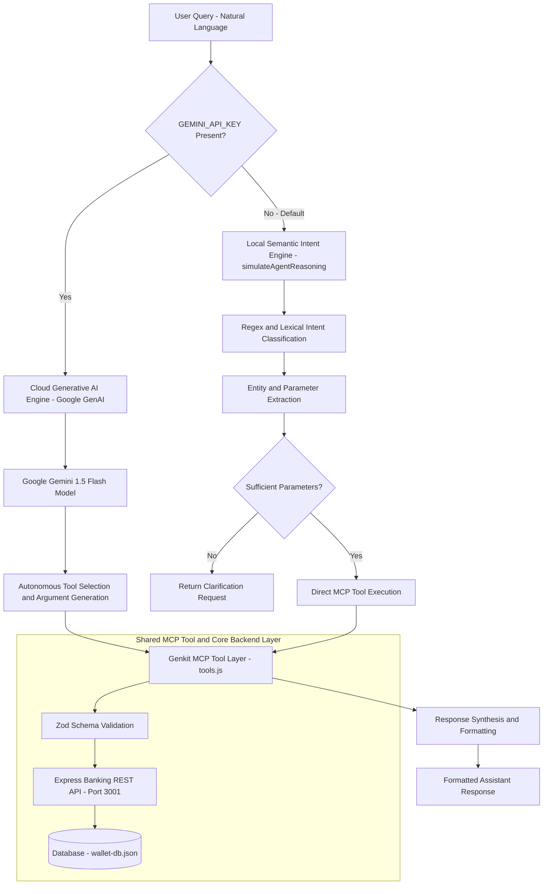
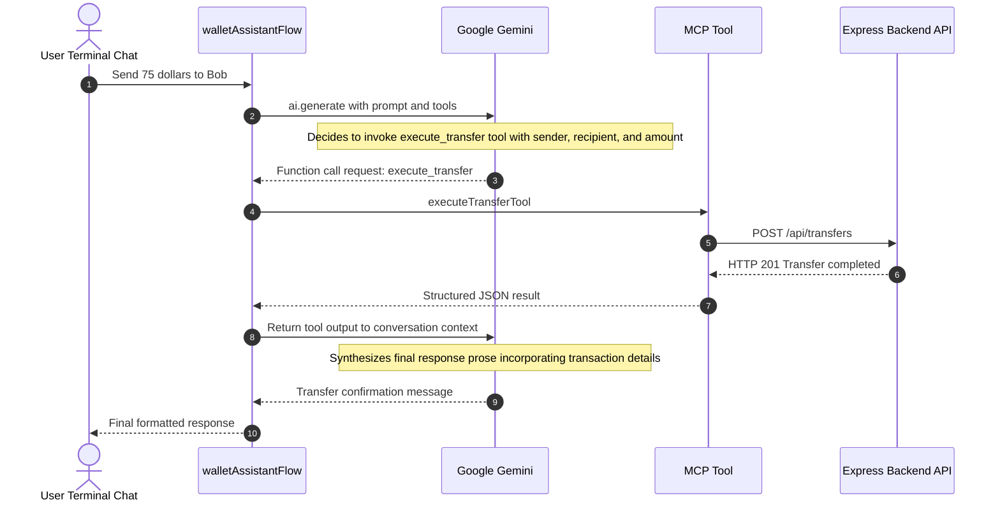

# Dual-Engine AI Architecture: Local Reasoning vs. Cloud LLM

This guide explains the dual-engine AI architecture implemented in this project. It covers how the **Local Offline Reasoning Engine** operates, how the **Cloud LLM-Powered Engine (Google Gemini)** operates, how both engines interface with the shared **Model Context Protocol (MCP)** tool layer, and how to configure and run either mode.

---

## 1. Architectural Overview

The application implements a **Dual-Engine Pattern** inside [`genkit-app/src/agent.js`](genkit-app/src/agent.js). The system switches between engines dynamically based on the presence of the `GEMINI_API_KEY` environment variable.



### Feature Comparison Matrix

| Architectural Dimension | Local Reasoning Engine (Offline) | Cloud Generative Engine (Gemini) |
| :--- | :--- | :--- |
| **Execution Environment** | 100% Local (Node.js runtime) | Hybrid (Local Genkit + Google Cloud AI API) |
| **External Network Required** | None (Fully air-gapped) | Outbound HTTPS to `generativelanguage.googleapis.com` |
| **API Key Required** | None ($0 cost, zero signup) | `GEMINI_API_KEY` (Free tier or Google Cloud billing) |
| **Reasoning Model** | Deterministic Pattern & Entity Matcher | Deep Neural Network (`gemini-1.5-flash`) |
| **Execution Latency** | 2 ms – 15 ms | 400 ms – 1,800 ms (network + token generation) |
| **Tool Calling Mechanism** | Direct invocation of tool functions | Autonomous LLM function calling via Genkit |
| **Input Flexibility** | Common phrasing, keywords, standard syntax | Freeform conversational phrasing, complex syntax, typos |
| **Output Style** | Structured, consistent markdown receipts | Dynamically generated conversational prose |
| **Primary Use Cases** | Local dev, CI/CD pipelines, offline workshops | Production chat, complex advisory, multi-turn dialogue |

---

## 2. The Local Reasoning Engine (Offline Mode)

### 2.1 Architectural Context: The Flow Entrypoint

The application exposes a single orchestration endpoint, `walletAssistantFlow`, defined in [`genkit-app/src/agent.js`](genkit-app/src/agent.js#L257-L315). When a query arrives, the flow checks whether a Gemini API key is configured in the environment:

```javascript
// genkit-app/src/agent.js (Lines 271-315)
const walletAssistantFlow = ai.defineFlow(
  {
    name: 'walletAssistantFlow',
    inputSchema: z.object({
      query: z.string().describe('The user inquiry or command regarding their wallet or payment'),
      userId: z.string().optional().default('user_101').describe('Default user ID of the authenticated user')
    }),
    outputSchema: z.object({
      query: z.string(),
      response: z.string(),
      toolCalls: z.array(z.any()),
      data: z.any()
    })
  },
  async ({ query, userId }) => {
    // 1. If Gemini API Key is available, invoke Cloud LLM with tools
    if (hasApiKey) {
      try {
        const { googleAI } = require('@genkit-ai/google-genai');
        const llmResponse = await ai.generate({
          model: googleAI.model('gemini-1.5-flash'),
          prompt: `You are an intelligent, helpful payment & digital wallet assistant.
The active user is "${userId || 'user_101'}".
Use the available tools to inspect balance, check transfer status, check top-up status, execute fund transfers, initiate top-ups, or get transaction history.
Always provide clear, secure, and professional banking responses.

User Query: ${query}`,
          tools: walletTools
        });

        return {
          query,
          response: llmResponse.text,
          toolCalls: llmResponse.messages || [],
          data: { mode: 'gemini-llm' }
        };
      } catch (err) {
        console.warn('[Genkit Agent] LLM generation error, falling back to simulated reasoning engine:', err.message);
      }
    }

    // 2. Default: Route directly to the Local Semantic Intent Engine
    const simulation = await simulateAgentReasoning(query, userId || 'user_101');
    return {
      query,
      response: simulation.response,
      toolCalls: [
        {
          tool: simulation.toolCalled,
          args: simulation.toolArgs,
          result: simulation.toolResult
        }
      ],
      data: {
        mode: 'mcp-tool-agent',
        toolResult: simulation.toolResult
      }
    };
  }
);
```

When `hasApiKey` is `false` (the default mode), the flow delegates to `simulateAgentReasoning(query, defaultUserId)`.

---

### 2.2 What is `simulateAgentReasoning()`?

`simulateAgentReasoning` is the core JavaScript function in [`genkit-app/src/agent.js`](genkit-app/src/agent.js#L30-L254) that powers the entire offline reasoning engine.

#### Why is it named `simulateAgentReasoning`?
In modern AI agent architectures, a Large Language Model (such as Google Gemini or OpenAI GPT-4) performs cognitive tasks:
1. **Natural Language Understanding**: Deciding what the user is asking for.
2. **Autonomous Tool Selection**: Choosing which tool from the tool registry will satisfy the request.
3. **Parameter Extraction**: Parsing entities from text to populate the tool's input schema.
4. **Tool Execution**: Invoking the tool and receiving the result.
5. **Response Generation**: Formulating human-facing text based on the tool's machine output.

When running offline without cloud API keys or an internet connection, **`simulateAgentReasoning` simulates this entire cognitive loop deterministically in code**. It acts as a 1-to-1 surrogate for an LLM agent.

#### Function Signature & Inputs
```javascript
// genkit-app/src/agent.js (Line 30)
async function simulateAgentReasoning(query, defaultUserId = 'user_101')
```
* **`query`** (`string`): The raw natural language message submitted by the user (e.g., *"Transfer $50 to Bob"* or *"What is my balance?"*).
* **`defaultUserId`** (`string`, optional): The authenticated user ID extracted from the session (defaults to `"user_101"`, Alice Smith).

#### Return Object Contract
`simulateAgentReasoning` returns a standardized object that mirrors the metadata produced by Genkit's `ai.generate()`:

```javascript
return {
  toolCalled: 'execute_transfer',               // Name of the MCP tool invoked
  toolArgs: { senderId, recipientId, amount }, // Strongly-typed arguments passed to the tool
  toolResult: result,                          // Structured JSON returned by the backend API
  response: text                               // Human-readable markdown response
};
```

#### How the Genkit Flow Consumes It
Inside `walletAssistantFlow`, the flow receives the output from `simulateAgentReasoning` and packages it into the flow's output schema:

```javascript
// genkit-app/src/agent.js (Lines 299-314)
const simulation = await simulateAgentReasoning(query, userId || 'user_101');
return {
  query,
  response: simulation.response,
  toolCalls: [
    {
      tool: simulation.toolCalled,
      args: simulation.toolArgs,
      result: simulation.toolResult
    }
  ],
  data: {
    mode: 'mcp-tool-agent',
    toolResult: simulation.toolResult
  }
};
```
From the perspective of any client calling the Genkit Flow (whether the terminal chat, web UI, or another microservice), the response format is identical whether it was generated by Google Gemini or by `simulateAgentReasoning`.

---

### 2.3 Deep Dive: Complete Code Walkthrough for Each Intent Branch

Inside `simulateAgentReasoning(query, defaultUserId)` ([`genkit-app/src/agent.js#L30-L254`](genkit-app/src/agent.js#L30-L254)), the engine evaluates queries against five distinct operational branches. Below is the code and logic for each branch.

---

#### 1. Input Sanitization & Normalization

```javascript
// genkit-app/src/agent.js (Lines 31-32)
async function simulateAgentReasoning(query, defaultUserId = 'user_101') {
  const q = query.trim();
  const lower = q.toLowerCase();
  // ...
```
* **`q`**: Preserves original case and characters (important for regex extraction of uppercase transaction codes like `TRF-1001` and user notes).
* **`lower`**: Lowercased representation used for fast keyword presence checks (`lower.includes('status')`).

---

#### 2. Branch 1: Checking Transfer Status (`check_transfer_status`)

This branch handles inquiries regarding past or pending fund transfers.

```javascript
// genkit-app/src/agent.js (Lines 34-60)
// 1. Transfer Status check: "check transfer status TRF-1002" or "status of TRF-1001" or "REF-TRF-001"
const trfMatch = q.match(/\b(TRF-\d+|REF-TRF-\d+)\b/i);
if ((lower.includes('transfer') && (lower.includes('status') || lower.includes('check'))) || trfMatch) {
  const transferId = trfMatch ? trfMatch[1] : 'TRF-1002';
  const result = await checkTransferStatusTool({ transferId });
  let text = '';
  if (result.success) {
    text = `Here is the status for Transfer **${result.transferId}** (Ref: ${result.referenceId}):\n` +
           `- **Status**: ${result.status === 'COMPLETED' ? '✅ COMPLETED' : result.status === 'PENDING' ? '⏳ PENDING' : '❌ FAILED'}\n` +
           `- **Amount**: ${result.formattedAmount}\n` +
           `- **Sender**: ${result.sender}\n` +
           `- **Recipient**: ${result.recipient}\n` +
           `- **Timestamp**: ${new Date(result.timestamp).toLocaleString()}\n` +
           `- **Note**: ${result.description}`;
    if (result.failureReason) {
      text += `\n- **Failure Reason**: ${result.failureReason}`;
    }
  } else {
    text = `❌ Could not find transfer with ID "${transferId}": ${result.error}`;
  }
  return {
    toolCalled: 'check_transfer_status',
    toolArgs: { transferId },
    toolResult: result,
    response: text
  };
}
```

* **Intent Regex**: `/\b(TRF-\d+|REF-TRF-\d+)\b/i` checks for codes like `TRF-1001` or `REF-TRF-001`. Word boundaries (`\b`) prevent matching accidental substrings.
* **Fallback Default**: If a user asks *"Check my transfer status"* without an ID, it checks `'TRF-1002'`.
* **Tool Invocation**: Calls `checkTransferStatusTool({ transferId })` from [`mcp-server/src/tools.js`](mcp-server/src/tools.js).
* **Synthesis**: Generates markdown containing status badges (`✅ COMPLETED`, `⏳ PENDING`, `❌ FAILED`), and prints `failureReason` if compliance or balance issues caused a failure.

---

#### 3. Branch 2: Top-Up Operations (Status Check vs. Initiation)

This branch handles both inspecting existing top-ups and generating new top-up payment requests.

```javascript
// genkit-app/src/agent.js (Lines 63-121)
// 2. Top-up Status check & Initiation
const topupMatch = q.match(/\b(TOP-\d+|REF-TOP-\d+)\b/i);
if (lower.includes('topup') || lower.includes('top up') || lower.includes('top-up')) {
  // Sub-branch 2A: Check Status ("status of topup TOP-5001" or "check topup status")
  if (lower.includes('status') || lower.includes('what is happening') || topupMatch) {
    const topupId = topupMatch ? topupMatch[1] : 'TOP-5002';
    const result = await checkTopupStatusTool({ topupId });
    let text = '';
    if (result.success) {
      text = `Here is the status for Top-up **${result.topupId}** (Ref: ${result.referenceId}):\n` +
             `- **Status**: ${result.status === 'SUCCESS' ? '✅ SUCCESS' : result.status === 'PENDING' ? '⏳ PENDING' : '❌ FAILED'}\n` +
             `- **User**: ${result.userName} (${result.userId})\n` +
             `- **Amount**: ${result.formattedAmount}\n` +
             `- **Payment Method**: ${result.paymentMethod}\n` +
             `- **Detail**: ${result.statusDetail}`;
      if (result.virtualAccountNumber) {
        text += `\n- **Virtual Account**: ${result.virtualAccountNumber} (${result.bank || 'Bank Partner'})`;
      }
    } else {
      text = `❌ Could not find top-up with ID "${topupId}": ${result.error}`;
    }
    return {
      toolCalled: 'check_topup_status',
      toolArgs: { topupId },
      toolResult: result,
      response: text
    };
  }

  // Sub-branch 2B: Initiate Top-up ("top up $100 using virtual account")
  const amountMatch = q.match(/\$?\s*(\d+(\.\d{1,2})?)/);
  const amount = amountMatch ? parseFloat(amountMatch[1]) : 50.00;
  let paymentMethod = 'VIRTUAL_ACCOUNT';
  if (lower.includes('credit') || lower.includes('card')) paymentMethod = 'CREDIT_CARD';
  if (lower.includes('bank transfer')) paymentMethod = 'BANK_TRANSFER';

  const userMatch = q.match(/user_\d+/i);
  const userId = userMatch ? userMatch[0] : defaultUserId;

  const result = await initiateTopupTool({ userId, amount, paymentMethod });
  let text = '';
  if (result.success) {
    text = `✅ Top-up request **${result.topupId}** created successfully for **${result.formattedAmount}**.\n` +
           `- **Payment Method**: ${result.paymentMethod}\n` +
           `- **Status**: ⏳ ${result.status}\n`;
    if (result.paymentInstructions.virtualAccountNumber) {
      text += `- **Virtual Account Number**: \`${result.paymentInstructions.virtualAccountNumber}\` (${result.paymentInstructions.bank})\n` +
              `- **Valid until**: ${new Date(result.paymentInstructions.expiryTime).toLocaleString()}`;
    } else if (result.paymentInstructions.checkoutUrl) {
      text += `- **Payment Link**: ${result.paymentInstructions.checkoutUrl}`;
    }
  } else {
    text = `❌ Failed to initiate top-up: ${result.error}`;
  }
  return {
    toolCalled: 'initiate_topup',
    toolArgs: { userId, amount, paymentMethod },
    toolResult: result,
    response: text
  };
}
```

* **Sub-Branch Routing**: If the query mentions `"status"`, `"what is happening"`, or includes a `TOP-xxxx` ID, it executes `checkTopupStatusTool`. Otherwise, it treats the request as a new top-up order.
* **Payment Method Normalization**: Distinguishes between `VIRTUAL_ACCOUNT` (default), `CREDIT_CARD`, and `BANK_TRANSFER`.
* **Payment Instructions**: Renders Virtual Account numbers, banking partner names, and expiration timestamps.

---

#### 4. Branch 3: Transaction History & Statement (`get_transaction_history`)

This branch retrieves the account's historical ledger.

```javascript
// genkit-app/src/agent.js (Lines 124-174)
// 3. Inquire History or Latest Transfer: "latest transfer", "last transfer", "recent transactions", "history", "statement"
const isHistoryOrLatest = lower.includes('history') ||
                          lower.includes('transactions') ||
                          lower.includes('statement') ||
                          lower.includes('past') ||
                          lower.includes('latest') ||
                          lower.includes('last') ||
                          lower.includes('recent');

if (isHistoryOrLatest && !lower.includes('send') && !lower.includes('pay to')) {
  const userMatch = q.match(/user_\d+/i);
  const userId = userMatch ? userMatch[0] : defaultUserId;
  const result = await getTransactionHistoryTool({ userId, limit: 10 });

  let text = '';
  if (result.success) {
    if (lower.includes('transfer')) {
      // Find latest transfer specifically
      const latestTransfer = result.transactions.find(
        (tx) => tx.type === 'TRANSFER_OUT' || tx.type === 'TRANSFER_IN'
      );
      if (latestTransfer) {
        text = `📋 **Your Latest Transfer (${latestTransfer.id})**:\n` +
               `- **Status**: ${latestTransfer.status === 'COMPLETED' ? '✅ COMPLETED' : latestTransfer.status === 'PENDING' ? '⏳ PENDING' : '❌ ' + latestTransfer.status}\n` +
               `- **Type**: ${latestTransfer.type === 'TRANSFER_OUT' ? 'Sent (Outflow)' : 'Received (Inflow)'}\n` +
               `- **Amount**: ${latestTransfer.formattedAmount}\n` +
               `- **Counterparty**: ${latestTransfer.counterparty}\n` +
               `- **Note**: ${latestTransfer.description}\n` +
               `- **Date**: ${new Date(latestTransfer.timestamp).toLocaleString()}`;
      } else {
        text = `No recent transfers found for ${userId}.`;
      }
    } else {
      // Show general transaction ledger
      text = `📜 **Recent Transactions for ${userId}** (${Math.min(5, result.transactions.length)} entries):\n`;
      result.transactions.slice(0, 5).forEach((tx, idx) => {
        const symbol = tx.type === 'TRANSFER_OUT' ? '📤' : tx.type === 'TRANSFER_IN' ? '📥' : '💳';
        text += `${idx + 1}. ${symbol} **${tx.id}** [${tx.status}] - **${tx.formattedAmount}**\n` +
                `   ${tx.description || tx.counterparty} • ${new Date(tx.timestamp).toLocaleDateString()}\n`;
      });
    }
  } else {
    text = `❌ Could not fetch transaction history: ${result.error}`;
  }

  return {
    toolCalled: 'get_transaction_history',
    toolArgs: { userId, limit: 10 },
    toolResult: result,
    response: text
  };
}
```

* **Precedence Guard**: Evaluated *before* Branch 4 (Transfer Execution) using `!lower.includes('send') && !lower.includes('pay to')`. This ensures that `"Show my latest transfer"` is recognized as an inquiry rather than a request to transfer money.
* **Targeted Lookups**: If the user asks for `"latest transfer"`, it filters the ledger for the most recent `TRANSFER_OUT` or `TRANSFER_IN`.
* **Directional Badges**: Uses `📤` for outgoing transfers, `📥` for incoming transfers, and `💳` for top-ups.

---

#### 5. Branch 4: Fund Transfer Execution (`execute_transfer`)

This branch executes money transfers between accounts.

```javascript
// genkit-app/src/agent.js (Lines 177-230)
// 4. Do Transfer: ONLY when explicit action intent ("transfer $50 to Bob", "send 30 to user_102")
if (lower.includes('transfer') || lower.includes('send') || lower.includes('pay')) {
  const amountMatch = q.match(/\$?\s*(\d+(\.\d{1,2})?)/);
  const recipientMatch = q.match(/(?:to\s+)(user_\d+|bob|charlie|alice)/i);

  // 🛡️ Safety Guard: Halt execution if amount is omitted
  if (!amountMatch) {
    return {
      toolCalled: 'none',
      toolArgs: {},
      toolResult: null,
      response: `❓ How much would you like to transfer, and to whom? Please specify the amount and recipient (e.g., *"Transfer $50 to Bob"* or *"Send $30 to user_102"*).`
    };
  }

  const amount = parseFloat(amountMatch[1]);
  let recipientId = 'user_102'; // default Bob
  if (recipientMatch) {
    const nameOrId = recipientMatch[1].toLowerCase();
    if (nameOrId === 'bob' || nameOrId === 'user_102') recipientId = 'user_102';
    else if (nameOrId === 'charlie' || nameOrId === 'user_103') recipientId = 'user_103';
    else if (nameOrId === 'alice' || nameOrId === 'user_101') recipientId = 'user_101';
    else recipientId = nameOrId;
  }

  const senderMatch = q.match(/(?:from\s+)(user_\d+)/i);
  const senderId = senderMatch ? senderMatch[1] : defaultUserId;

  const result = await executeTransferTool({
    senderId,
    recipientId,
    amount,
    description: `Transfer initiated via Genkit Assistant: "${q}"`
  });

  let text = '';
  if (result.success) {
    text = `🎉 **Transfer Successful!**\n` +
           `- **Transaction ID**: ${result.transferId}\n` +
           `- **Amount Sent**: ${result.formattedAmount}\n` +
           `- **From**: ${result.senderName} (${result.senderId})\n` +
           `- **To**: ${result.recipientName} (${result.recipientId})\n` +
           `- **Your Remaining Balance**: **${result.formattedRemainingBalance}**\n` +
           `- **Timestamp**: ${new Date(result.timestamp).toLocaleString()}`;
  } else {
    text = `❌ **Transfer Failed**: ${result.error}`;
  }

  return {
    toolCalled: 'execute_transfer',
    toolArgs: { senderId, recipientId, amount },
    toolResult: result,
    response: text
  };
}
```

* **Conversational Guardrail**: If `amountMatch` is `null`, it returns a prompt asking for details without touching the backend or debiting money.
* **Name Alias Resolution**: Maps `"bob"` $\rightarrow$ `user_102`, `"charlie"` $\rightarrow$ `user_103`, `"alice"` $\rightarrow$ `user_101`.
* **Atomic Execution**: Calls `executeTransferTool`, which verifies account statuses and balances via the Express REST API and commits atomic changes to `backend/data/wallet-db.json`.

---

#### 6. Branch 5: Balance Inquiry Fallback (`get_wallet_balance`)

This branch acts as the baseline handler when no other action matches.

```javascript
// genkit-app/src/agent.js (Lines 232-254)
// 5. Balance Inquiry: default
const userMatch = q.match(/user_\d+/i);
const userId = userMatch ? userMatch[0] : defaultUserId;
const result = await getWalletBalanceTool({ userId });

let text = '';
if (result.success) {
  text = `💼 **Wallet Summary for ${result.accountHolder} (${result.userId})**:\n` +
         `- **Current Balance**: **${result.formattedBalance}**\n` +
         `- **Account Status**: ${result.status === 'ACTIVE' ? '🟢 ACTIVE' : '🔴 ' + result.status}\n` +
         `- **Tier**: ${result.tier}\n` +
         `- **Daily Transfer Limit**: $${result.dailyLimit.toFixed(2)}`;
} else {
  text = `❌ Could not find wallet for user "${userId}": ${result.error}`;
}

return {
  toolCalled: 'get_wallet_balance',
  toolArgs: { userId },
  toolResult: result,
  response: text
};
```

* **Default Route**: Catches balance inquiries (*"What is my balance?"*, *"How much do I have left?"*) and general greetings.
* **Synthesis**: Outputs current balance, account status badge (`🟢 ACTIVE`), tier (`PREMIUM`), and daily spending limit.

---

### 2.4 Operational Characteristics

* **Latency**: 2 ms – 15 ms execution time per turn (instantaneous local evaluation).
* **Cost**: $0.00 (Zero tokens consumed, zero external API calls).
* **Reliability**: 100% deterministic outputs, ideal for automated CI/CD test suites and offline workshops.
* **Tool Parity**: Tool arguments, validation schemas, and database persistence are identical to cloud LLM mode.

---

### 2.3 Operational Characteristics

* **Latency**: 2 ms – 15 ms execution time per turn (instantaneous local evaluation).
* **Cost**: $0.00 (Zero tokens consumed, zero external API calls).
* **Reliability**: 100% deterministic outputs, ideal for automated CI/CD test suites and offline workshops.
* **Tool Parity**: Tool arguments, validation schemas, and database persistence are identical to cloud LLM mode.

---

## 3. The Cloud LLM-Powered Engine (Google Gemini Mode)

### 3.1 File Location & Implementation
* **Genkit Configuration**: [`genkit-app/src/genkit.js`](genkit-app/src/genkit.js)
* **Agent Flow**: [`genkit-app/src/agent.js`](genkit-app/src/agent.js) (`ai.generate`)

When an API key is configured, the system loads the `@genkit-ai/google-genai` plugin and routes queries through Google Gemini 1.5 Flash.

---

### 3.2 Autonomous Function Calling Flow

Instead of hardcoded regex matchers, the Gemini neural network inspects the tool schemas and orchestrates execution dynamically:



### 3.3 Genkit Code Structure

In [`genkit-app/src/genkit.js`](genkit-app/src/genkit.js):
```javascript
const { genkit } = require('genkit');

let plugins = [];
if (process.env.GEMINI_API_KEY) {
  const { googleAI } = require('@genkit-ai/google-genai');
  plugins.push(googleAI());
}

const ai = genkit({ plugins });
```

In [`genkit-app/src/agent.js`](genkit-app/src/agent.js):
```javascript
if (hasApiKey) {
  const { googleAI } = require('@genkit-ai/google-genai');
  const llmResponse = await ai.generate({
    model: googleAI.model('gemini-1.5-flash'),
    prompt: `You are an intelligent, helpful payment & digital wallet assistant.
The active user is "${userId || 'user_101'}".
Use the available tools to inspect balance, check transfer status, check top-up status, execute fund transfers, initiate top-ups, or get transaction history.
Always provide clear, secure, and professional banking responses.

User Query: ${query}`,
    tools: walletTools
  });

  return {
    query,
    response: llmResponse.text,
    toolCalls: llmResponse.messages || [],
    data: { mode: 'gemini-llm' }
  };
}
```

### 3.4 Automatic Cloud-to-Local Fallback
If the cloud API call encounters an error (such as network disconnection, quota exhaustion, or an invalid API key), `genkit-app/src/agent.js` intercepts the exception and seamlessly falls back to the local reasoning engine without crashing the user session:

```javascript
try {
  // Cloud LLM invocation
} catch (err) {
  console.warn('[Genkit Agent] LLM generation error, falling back to simulated reasoning engine:', err.message);
  // Executes simulateAgentReasoning(...)
}
```

---

## 4. The Shared Tool Contract: Model Context Protocol (MCP)

A critical principle of this architecture is that **neither the backend nor the tools change when switching engines**:

```
                 ┌────────────────────────────────┐
                 │    Local Reasoning Engine      │
                 └───────────────┬────────────────┘
                                 │
                                 ├──► [ executeTransferTool(args) ]
                                 │
                 ┌───────────────┴────────────────┐
                 │     Cloud Gemini 1.5 Model     │
                 └────────────────────────────────┘
                                 │
                                 ▼
                 ┌────────────────────────────────┐
                 │      mcp-server/src/tools.js   │
                 │      • Zod Schema Validation   │
                 │      • Backend HTTP Client     │
                 └───────────────┬────────────────┘
                                 ▼
                 ┌────────────────────────────────┐
                 │      Express REST Backend      │
                 │      (backend/src/server.js)   │
                 └────────────────────────────────┘
```

* **Zod Schemas Guarantee Type Safety**: Both engines must satisfy the identical schema declarations. If Gemini hallucinates an invalid argument type, Zod rejects the call before it touches the backend.
* **Zero Code Duplication**: Tool logic, business validation, and HTTP endpoints are written once and shared across both engines and external MCP clients (Claude Desktop, Cursor).

---

## 5. Setup and Execution Guide

### Mode 1: Local Offline Mode (Default)

This mode runs out of the box with zero external dependencies and zero API keys.

#### Step 1: Verify Configuration
Ensure `.env` either does not exist or has `GEMINI_API_KEY` left empty:
```bash
# Verify no API key is active
echo $GEMINI_API_KEY
```

#### Step 2: Run Any Component
All scripts work immediately in offline mode:

* **Interactive Terminal Chat**:
  ```bash
  npm run chat
  ```
  *(Notice the response latency is near-instantaneous, and outputs contain structured receipts).*

* **Automated End-to-End Walkthrough**:
  ```bash
  npm run e2e
  ```

* **Firebase Genkit Developer Web UI**:
  ```bash
  npm run ui
  ```
  Open `http://localhost:4000` to run flows and view traces.

---

### Mode 2: Cloud Generative AI Mode (Google Gemini)

To enable live neural generation and conversational flexibility using Google Gemini 1.5 Flash:

#### Step 1: Obtain a Gemini API Key
1. Visit the [Google AI Studio Console](https://aistudio.google.com/).
2. Sign in with your Google account.
3. Click **Get API key** and generate a new key.

#### Step 2: Configure Environment
You can configure the key via the `.env` file or export it directly in your terminal:

**Option A: Using the `.env` file (Persistent)**:
```bash
cp .env.example .env
```
Edit `.env` and set:
```env
GEMINI_API_KEY=AIzaSyYourActualKeyHere
BACKEND_PORT=3001
BACKEND_API_URL=http://localhost:3001
```

**Option B: Exporting in your terminal session (Temporary)**:
```bash
export GEMINI_API_KEY="AIzaSyYourActualKeyHere"
```

#### Step 3: Run and Verify
Start the terminal chat interface:
```bash
npm run chat
```

**How to verify Cloud Mode is active**:
1. Ask conversational questions with variable phrasing:
   * `"Could you please let me know Alice's remaining balance?"`
   * `"Hey assistant, I had lunch with Bob today. Please send him 25 bucks from my wallet."`
2. The agent generates dynamic, conversational responses powered by Gemini.
3. In the Genkit UI (`npm run ui` at `http://localhost:4000`), flow run traces will display `gemini-1.5-flash` model invocation spans and token consumption metrics.

---

## 6. How to Switch Modes Dynamically

You do not need to recompile, rebuild, or re-install packages to switch modes:

```bash
# Switch to Cloud Mode:
export GEMINI_API_KEY="AIzaSy..."
npm run chat

# Switch back to Local Offline Mode:
unset GEMINI_API_KEY
npm run chat
```

---

## 7. Troubleshooting & Operational Guidance

### 1. Cloud Mode Warning: "Could not load @genkit-ai/google-genai"
* **Cause**: The package was not installed or corrupted.
* **Resolution**: Run `npm install @genkit-ai/google-genai` and restart the application.

### 2. Network Timeouts or Quota Exceeded in Cloud Mode
* **Behavior**: If the Gemini API returns a `429 Too Many Requests` or network timeout, the application logs a warning and automatically routes the request through the local reasoning engine so the user request still succeeds.
* **Log message**:
  ```
  [Genkit Agent] LLM generation error, falling back to simulated reasoning engine: Quota exceeded
  ```

### 3. Resetting State Between Mode Switches
To ensure both engines test against the exact same baseline data:
```bash
npm run reset-db
```
This restores all wallet balances (`Alice: $1,250.00`, `Bob: $320.50`, `Charlie: $45.00`) and resets the transaction ledger.