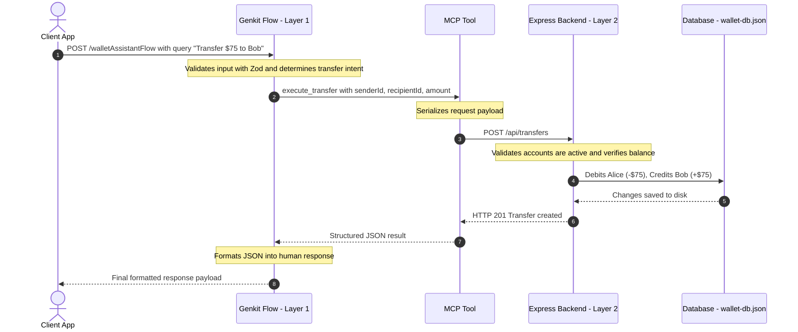

# System Architecture: Genkit Flows, MCP Tools, and Backend APIs

This document provides a technical explanation of how Firebase Genkit, the Model Context Protocol (MCP), and backend services interact to power an AI-enabled digital wallet system.

---

## 1. Architectural Component Definitions

An enterprise AI application is organized into four distinct architectural components:

```
┌─────────────────────────────────────────────────────────────────────────────┐
│ 1. THE FLOW (The Orchestration API)                                         │
│    • Framework: Firebase Genkit (`ai.defineFlow`)                           │
│    • Location: `genkit-app/src/agent.js`                                    │
│    • Definition: An AI-powered API endpoint that accepts natural language   │
│      requests, coordinates LLM generation, manages trace telemetry, and     │
│      delivers formatted responses back to clients.                          │
└──────────────────────────────────────┬──────────────────────────────────────┘
                                       │
                                       ▼ Discovers & calls
┌─────────────────────────────────────────────────────────────────────────────┐
│ 2. THE TOOLS (The Execution Capabilities)                                   │
│    • Framework: Genkit Tool SDK (`ai.defineTool`) / MCP Standard            │
│    • Location: `mcp-server/src/tools.js`                                    │
│    • Definition: Atomic, schema-validated functions (`Zod`) that translate  │
│      AI function-call requests into concrete HTTP operations.               │
└──────────────────────────────────────┬──────────────────────────────────────┘
                                       │
                                       ▼ Executes HTTP requests
┌─────────────────────────────────────────────────────────────────────────────┐
│ 3. THE BACKEND API (The System of Record)                                   │
│    • Framework: Express.js REST API                                         │
│    • Location: `backend/src/server.js`                                      │
│    • Definition: The core banking service that validates financial rules,   │
│      manages accounts, and commits atomic debit/credit database updates.    │
└──────────────────────────────────────┬──────────────────────────────────────┘
                                       │
                                       ▼ Serializes state
┌─────────────────────────────────────────────────────────────────────────────┐
│ 4. THE DATABASE (Persistent Storage)                                        │
│    • Location: `backend/data/wallet-db.json`                                │
│    • Definition: The storage layer holding wallet balances, transfer        │
│      ledgers, and top-up records.                                           │
└─────────────────────────────────────────────────────────────────────────────┘
```

---

## 2. In-Depth Component Analysis

### A. What is the Backend API?
* **Location in Code**: [`backend/src/server.js`](backend/src/server.js)
* **Role**: The **System of Record**.

The Backend API is a standard REST API. It is completely independent of Genkit and LLMs. It handles all business logic, authorization, data validation, and database operations.

Key characteristics:
* Exposes standard endpoints: `GET /api/wallets/:id`, `POST /api/transfers`, `POST /api/topups`.
* Enforces deterministic business rules (e.g., verifying sufficient balance, rejecting transfers to frozen accounts).
* Executes atomic ledger operations (debiting sender, crediting recipient).
* Returns structured JSON payloads with HTTP status codes (`200 OK`, `201 Created`, `400 Bad Request`).

---

### B. What is a Tool?
* **Location in Code**: [`mcp-server/src/tools.js`](mcp-server/src/tools.js)
* **Role**: The **Interface Between AI and Code**.

Large Language Models (LLMs) cannot query databases, make network requests, or debit bank accounts on their own. They are text-in, text-out neural networks.

A **Tool** is a structured wrapper that gives an AI model the ability to perform an external action:
1. **Schema Declaration**: Defines exact expected inputs and descriptions using `Zod` (e.g., `senderId: string`, `amount: number`).
2. **Execution Handler**: Contains the code that runs when the AI requests that action (e.g., calling `POST /api/transfers`).
3. **Serialization**: Packages the backend's JSON response and feeds it back into the model context.

Tools are the building blocks that both Genkit and external MCP clients (Claude Desktop, Cursor) use to interact with your system.

---

### C. What is a Flow?
* **Location in Code**: [`genkit-app/src/agent.js`](genkit-app/src/agent.js)
* **Role**: The **AI Orchestration API Endpoint**.

A **Flow** is an API endpoint specifically designed for AI workloads. In traditional Express development, you write route handlers like `app.post('/api/users')`. In Firebase Genkit, you write **Flows** like `ai.defineFlow(...)`.

A Flow manages the complete lifecycle of an AI request:
* **Input Validation**: Uses `Zod` to validate the incoming client payload (`query`, `userId`).
* **Model Invocation**: Feeds the prompt and available tools into the LLM.
* **Tool Call Loop**: If the LLM indicates it wants to call a tool (e.g., `execute_transfer`), the Flow executes the tool and passes the output back to the LLM.
* **Telemetry & Tracing**: Genkit automatically captures execution traces, latency, model parameters, and errors, viewable in the Developer UI (`localhost:4000`).
* **Deployment Target**: A Flow can be exposed via HTTP, tested in the Genkit UI, or deployed directly as a Google Cloud Function or Cloud Run service.

---

### D. What is the AI Agent?
* **Role**: The **Reasoning Engine Inside the Flow**.

The AI Agent is the logical component (the LLM or semantic intent router) that operates inside the Flow. It bridges the gap between human language and structured tools:
1. It reads unstructured text: *"Send 50 dollars to Bob for pizza"*.
2. It determines the user's intent: *"This is a fund transfer"*.
3. It maps text to parameters: `{ senderId: "user_101", recipientId: "user_102", amount: 50 }`.
4. It calls the corresponding Tool: `execute_transfer`.

---

### E. What is Model Context Protocol (MCP)?
* **Location in Code**: [`mcp-server/src/std-mcp-server.js`](mcp-server/src/std-mcp-server.js)
* **Role**: The **Universal Open Tool Protocol**.

Model Context Protocol (MCP) is an open standard created to unify how AI applications expose and consume tools.

Without MCP:
* An engineer must write separate tool adapters for OpenAI, Anthropic, LangChain, and Genkit.

With MCP:
* You define your wallet tools **once**.
* Those tools are exposed over a standardized protocol (`stdio` or Server-Sent Events).
* Any MCP-compatible host—including **Firebase Genkit**, **Claude Desktop**, **Cursor IDE**, or custom agents—can automatically discover and execute those tools without code changes.

---

## 3. The Dual-Layer API Pattern Explained

In production architectures, this design is known as the **Dual-Layer API Pattern**:

```
Layer 1: The AI Orchestration Layer (Genkit Flow)
   ▲     • Consumer: End users, chat interfaces, mobile assistants.
   │     • Accepts: Natural language, conversational messages.
   │     • Responsibility: Intent classification, tool routing, response formulation.
   │
   ▼
Layer 2: The Core Business Layer (Express Backend API)
         • Consumer: The AI Tools (or direct mobile app forms).
         • Accepts: Strictly-typed JSON REST requests.
         • Responsibility: Ledger persistence, financial constraints, database integrity.
```

### Purpose of Having Two Layers:

1. **Separation of Concerns**:
   The Core Backend API remains clean, secure, and focused solely on banking operations. It does not need to know about prompt engineering, LLM tokens, or conversation history.

2. **Deterministic vs. Non-Deterministic Paths**:
   * When a mobile app user fills out an explicit transfer form (`Recipient: Bob`, `Amount: $50`) and clicks **Submit**, the app calls **Layer 2 (The Backend REST API)** directly.
   * When a user talks to a conversational assistant (*"Can you reimburse Bob for yesterday?"*), the client calls **Layer 1 (The Genkit Flow)** to analyze and execute the operation.

3. **Security and Access Control**:
   The AI never writes directly to the database. It must call the Tool, which in turn must satisfy all authentication, validation, and balance checks enforced by the Backend API.

---

## 4. End-to-End Execution Trace

The following diagram tracks the lifecycle of an operation from human input to database update and formatted receipt:



---

## 5. Technical Comparison Matrix

| Property | Core Backend API | MCP Tool | Genkit Flow |
| :--- | :--- | :--- | :--- |
| **Primary Consumer** | MCP Tools, Mobile App Forms | LLM (AI Models), MCP Clients | Web Frontends, Mobile Apps, Chat Clients |
| **Input Format** | Typed HTTP JSON / Query Params | Validated Zod Object Schema | Typed Input Schema (Query, Context) |
| **Output Format** | HTTP Status + JSON Body | JSON Result Object | Formatted Text Response + Trace Telemetry |
| **State Modification** | Directly mutates database | Indirect (calls Backend API) | Orchestrates (calls Tools) |
| **Telemetry / Tracing** | Standard server logs / APM | Tool execution logs | Automatic OpenTelemetry spans & visual DAG traces |
| **Standalone Runnable** | Yes (`npm run backend`) | Yes (`npm run mcp:std`) | Yes (`npm run ui`) |

---

## 6. Codebase Reference Map

* **Backend API Implementation**: [`backend/src/server.js`](backend/src/server.js) — REST routing and HTTP endpoints.
* **Database & Transaction Logic**: [`backend/src/db.js`](backend/src/db.js) — Business rules and state persistence.
* **Tool Schemas & Handlers**: [`mcp-server/src/tools.js`](mcp-server/src/tools.js) — Zod schemas and API client invocation.
* **Standard MCP Server**: [`mcp-server/src/std-mcp-server.js`](mcp-server/src/std-mcp-server.js) — Standard stdio transport for external AI clients.
* **Genkit Initialization**: [`genkit-app/src/genkit.js`](genkit-app/src/genkit.js) — Shared Genkit registry.
* **Genkit Flow Logic**: [`genkit-app/src/agent.js`](genkit-app/src/agent.js) — `walletAssistantFlow` and action workflows.
* **Terminal Interface**: [`genkit-app/src/cli.js`](genkit-app/src/cli.js) — Chat UI loop communicating with the Flow.

---

## 7. The AI Implementation: Offline-First Architecture

> 📖 **Dedicated Guide**: For a comprehensive deep dive into code implementations, autonomous tool-calling loops, and setup instructions for both modes, see the **[Dual-Engine AI Architecture Guide (AI_ENGINES_GUIDE.md)](AI_ENGINES_GUIDE.md)**.

Modern enterprise development demands that local developer environments, integration tests, and CI/CD pipelines run reliably without external cloud dependencies, paid API keys, or network flakiness.

To satisfy this requirement, the application implements a **Dual-Engine Architecture** inside [`genkit-app/src/agent.js`](genkit-app/src/agent.js).

```
                      ┌─────────────────────────────────┐
                      │    User Query (Natural Text)    │
                      └────────────────┬────────────────┘
                                       │
                         [GEMINI_API_KEY Present?]
                                      / \
                                     /   \
                             Yes    /     \    No (Default)
                                   ▼       ▼
┌────────────────────────────────────┐   ┌────────────────────────────────────┐
│      ENGINE A: CLOUD LLM ENGINE    │   │  ENGINE B: LOCAL SEMANTIC ENGINE   │
│  • Google Gemini 1.5 Flash         │   │  • Zero external network calls     │
│  • Dynamic multi-turn reasoning    │   │  • Deterministic regex & NLP       │
│  • Autonomous tool calling         │   │  • Schema-validated tool execution │
└──────────────────┬─────────────────┘   └─────────────────┬──────────────────┘
                   │                                       │
                   └───────────────────┬───────────────────┘
                                       ▼
                       ┌────────────────────────────────┐
                       │     Shared Genkit/MCP Tools    │
                       │    (mcp-server/src/tools.js)   │
                       └────────────────┬───────────────┘
                                       ▼
                       ┌────────────────────────────────┐
                       │       Core Express Backend     │
                       │     (http://localhost:3001)    │
                       └────────────────────────────────┘
```

---

### 7.1 The Dual-Engine Mechanism

The entry point of the AI layer is `walletAssistantFlow` in [`genkit-app/src/agent.js`](genkit-app/src/agent.js). It evaluates environment configuration at runtime:

1. **Engine A: Cloud Generative AI (`@genkit-ai/google-genai`)**:
   * Activated when `process.env.GEMINI_API_KEY` is present.
   * Invokes `ai.generate()` using `gemini-1.5-flash`.
   * Supplies the list of registered MCP tools (`walletTools`).
   * The Gemini neural network autonomously selects tools, parses arguments, and generates dynamic conversational prose.

2. **Engine B: Local Semantic Intent Engine (`simulateAgentReasoning`)**:
   * Activated by default when `GEMINI_API_KEY` is omitted.
   * Operates completely offline with zero latency, zero token costs, and zero external network calls.
   * Executes the complete agent workflow: **Intent Classification → Entity Extraction → Tool Execution → Response Synthesis**.

---

### 7.2 Handling All AI Use Cases in Offline Mode

The offline engine handles the full spectrum of AI agent responsibilities:

#### 1. Intent Classification
The engine parses natural language expressions and determines the user's operational goal:
* **Balance Inquiries**: Identified by terms such as *"balance"*, *"how much money"*, *"account status"*. Maps to `get_wallet_balance`.
* **Transfer Status Checks**: Identified by terms like *"transfer status"*, *"check transfer"*, or references to transfer identifiers (`TRF-xxxx`). Maps to `check_transfer_status`.
* **Top-Up Status Inquiries**: Identified by keywords like *"topup status"*, *"what is happening with my topup"*, or top-up IDs (`TOP-xxxx`). Maps to `check_topup_status`.
* **Transaction History Queries**: Identified by terms like *"statement"*, *"recent transactions"*, *"history"*, *"latest transfer"*. Maps to `get_transaction_history`.
* **Fund Transfer Execution**: Identified by action verbs such as *"transfer"*, *"send"*, *"pay"*. Maps to `execute_transfer`.
* **Top-Up Requests**: Identified by action phrases like *"top up"*, *"add funds"*, *"deposit"*. Maps to `initiate_topup`.

#### 2. Entity and Parameter Extraction
Once an intent is recognized, the engine extracts structured parameters required by the tool schemas:
* **Monetary Values**: Regex patterns extract values prefixed by `$` or bare decimals (e.g., `"$35"`, `"50.00"`) and converts them to floating-point numbers.
* **Account and Counterparty Resolution**: Resolves textual names to canonical database identifiers (e.g., `"Bob"` maps to `user_102`, `"Charlie"` maps to `user_103`, `"Alice"` maps to `user_101`).
* **Payment Methods**: Classifies phrases such as *"virtual account"*, *"credit card"*, or *"bank transfer"* into enum values (`VIRTUAL_ACCOUNT`, `CREDIT_CARD`, `BANK_TRANSFER`).
* **Transaction Identifiers**: Extracts bounded alphanumeric codes matching `TRF-\d+` and `TOP-\d+`.

#### 3. Conversational Safety Guards and Clarification Prompts
Unlike naive keyword matchers that might execute irreversible financial transactions with incomplete data, the engine enforces safety guards:
* If a user says *"transfer to Bob"* without specifying an amount, the engine intercepts the execution and returns a clarification prompt:
  > *"How much would you like to transfer, and to whom? Please specify the amount and recipient (e.g., 'Transfer $50 to Bob')."*
* It prevents unintended monetary debits when the user intent is underspecified.

#### 4. Shared Tool Execution
The offline engine does **not** bypass the MCP tool layer. It directly invokes the same registered Genkit tools (`checkTransferStatusTool`, `executeTransferTool`, etc.) used by the cloud LLM:
* Arguments pass through `Zod` validation.
* Tools invoke the HTTP API client (`backend/src/client.js`).
* Database state updates atomically via the Core Backend API.

#### 5. Natural Language Response Synthesis
After the tool returns structured JSON data from the backend, the engine synthesizes a formatted, professional response:
* Formats currencies (`$1,200.00 USD`).
* Converts ISO timestamps into localized date/time strings.
* Attaches visual status indicators (`🟢 ACTIVE`, `✅ COMPLETED`, `⏳ PENDING`, `❌ FAILED`).
* Presents payment instructions, including Virtual Account numbers and expiry dates.

---

### 7.3 Enterprise Benefits of Offline-First AI Architecture

1. **Instant Developer Onboarding**:
   New engineers can clone the repository and run `npm run e2e` or `npm run chat` within seconds. No Google Cloud IAM provisioning, API keys, or credit card configurations are required.

2. **Deterministic Automated CI/CD Testing**:
   Cloud LLM responses vary between runs due to model non-determinism, network latency, and provider outages. The offline engine guarantees deterministic outputs, enabling integration tests and regression suites to run reliably in GitHub Actions or any automated build pipeline.

3. **Air-Gapped Security and Financial Privacy**:
   In regulated banking environments, sending customer balances, account numbers, or ledger entries to public cloud LLM endpoints may violate compliance policies (e.g., PCI-DSS, SOC 2, GDPR). Offline-first development ensures sensitive financial data never leaves the local developer machine.

4. **Zero-Code-Change Cloud Promotion**:
   The transition from local offline testing to production cloud generation requires zero code modifications:
   ```bash
   # Add your key to .env or environment variables
   export GEMINI_API_KEY="AIzaSyYourActualGeminiKey"

   # Restart the application
   npm run chat
   ```
   The application detects the key, loads `@genkit-ai/google-genai`, and seamlessly switches to the Gemini 1.5 Flash foundation model while continuing to use the exact same MCP tools and backend endpoints.
